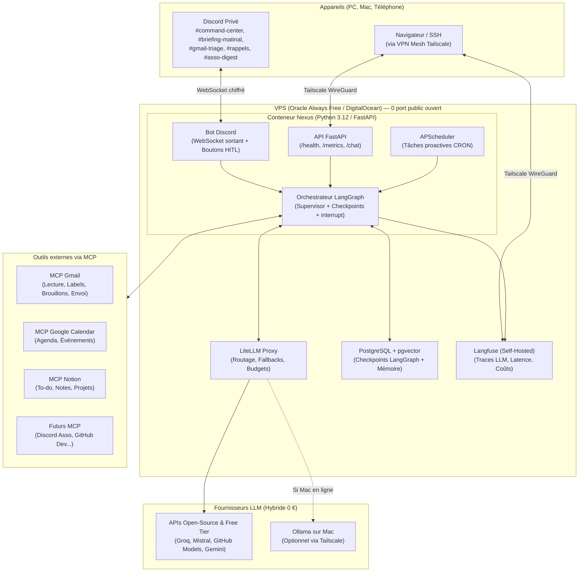
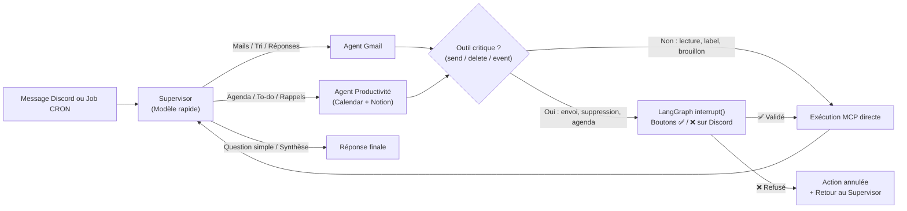

# Blueprint d'Architecture — Plateforme Multi-Agents « Nexus »

> [!IMPORTANT]
> Ce blueprint récapitule l'architecture cible validée lors de l'atelier. Il combine une **plateforme multi-agents moderne** (LangGraph + MCP + LiteLLM) et des **pratiques DevOps / LLMOps** pensées pour un coût de **0 € à ~4 €/mois** et un impact maximal sur un CV Master DevOps.

---

## 1. Vue d'ensemble de l'architecture

### Pourquoi cette architecture est « CV-ready »
- **Zéro port exposé sur Internet** : le bot Discord utilise une connexion WebSocket sortante ; l'API, Langfuse et le SSH ne sont accessibles que via **Tailscale**.
- **Découplage total des LLM** : le code LangGraph ne dépend d'aucun fournisseur ; tout passe par **LiteLLM Proxy** (routage, fallback automatique, suivi de budget).
- **Extensibilité par configuration** : l'ajout d'un nouvel outil ou agent (ex. Discord asso, agent Dev GitHub) passe par le **Model Context Protocol (MCP)**.
- **Sécurité par conception (Human-in-the-Loop)** : les actions à impact externe déclenchent un `interrupt()` LangGraph persisté en base PostgreSQL jusqu'à validation via bouton Discord.

---

## 2. Graphe Multi-Agents & Human-in-the-Loop (LangGraph)

### Matrice d'autonomie et garde-fous (HITL)

| Service | Actions autonomes (sans validation) | Actions critiques (Validation ✅ / ❌ sur Discord) |
| :--- | :--- | :--- |
| **Gmail** | Lire, résumer, rechercher, appliquer des labels, archiver les newsletters identifiées, **créer des brouillons** | **Envoyer un mail**, répondre directement, supprimer définitivement |
| **Google Calendar** | Lire l'agenda, détecter les conflits, proposer des créneaux | **Créer, modifier ou supprimer un événement**, envoyer une invitation |
| **Notion** | Lire les bases/tâches, créer/mettre à jour une tâche dans ta base perso | Supprimer ou archiver des pages / bases |
| **Discord (Asso — V2)** | Lire et résumer les salons autorisés | Poster un message sur le serveur de l'association |

> [!TIP]
> Pour tester immédiatement sans risque ni configuration OAuth complexe, le squelette de code inclut un mode `MOCK_TOOLS=true` qui simule Gmail, Google Calendar et Notion tout en exécutant le **vrai graphe LangGraph** et le **vrai flux de validation HITL**.

---

## 3. Organisation du serveur Discord privé

| Salon | Rôle | Mode |
| :--- | :--- | :--- |
| `#command-center` | Interface principale avec le **Supervisor** (tu poses des questions, donnes des ordres, valides les boutons ✅/❌) | Réactif (Chat) |
| `#briefing-matinal` | Synthèse automatique à **08h00** : agenda du jour, tâches Notion prioritaires, mails importants | Proactif (CRON) |
| `#gmail-triage` | Digest périodique des mails triés, brouillons prêts à relire et demandes de validation d'envoi | Proactif + HITL |
| `#rappels` | Relances intelligentes sur les échéances Notion et mails sans réponse | Proactif (CRON) |
| `#asso-digest` *(V2)* | Résumé quotidien de l'activité du serveur Discord de ton association + proposition de tâches Notion | Proactif (CRON) |

---

## 4. Stratégie LLM Hybride (objectif 0 € — LiteLLM Proxy)

L'application ne parle qu'à **LiteLLM** via 3 alias logiques définis dans `config/litellm_config.yaml` :

1. **`nexus-fast`** *(Supervisor, routage, tri Gmail, résumés)* :
   - Primaire : **Groq** (`llama-3.3-70b-versatile`) ou **Gemini Flash** (Free Tier) — ultra rapide, gratuit.
   - Fallback 1 : **GitHub Models** (inclus dans GitHub Student).
   - Fallback 2 : **Mistral** (Free Tier / `mistral-small-latest`).
2. **`nexus-smart`** *(Rédaction de mails complexes, planification multi-étapes, futur agent Dev)* :
   - Primaire : **Gemini 2.5 Flash / Pro** ou **GitHub Models** (`gpt-4o` / `Llama-3.3-70B` / `DeepSeek`).
   - Fallback : **OpenRouter** (modèles open-source ou low-cost).
3. **`nexus-local`** *(Optionnel — tâches 100 % privées)* :
   - Pointe vers **Ollama** sur ton Mac via son IP **Tailscale** (`http://100.x.y.z:11434`), avec fallback automatique vers `nexus-fast` si ton Mac est éteint.

---

## 5. Architecture DevOps & Déploiement (Master DevOps)

### Hébergement recommandé (0 €)
1. **Oracle Cloud Always Free** : 1 instance ARM Ampere (`VM.Standard.A1.Flex`, 4 OCPU / 24 Go RAM). Tu y fais tourner confortablement Docker Compose (Nexus + LiteLLM + PostgreSQL + Langfuse) voire **k3s** en V2.
2. **Alternative avec GitHub Student** : **DigitalOcean** (200 \$ de crédit étudiant, ex. Droplet 4 Go RAM ~24 \$/mois gratuits pendant ~8 mois) ou **Azure for Students** (100 \$).

### Pipeline & Sécurité (progressif)
- **Conteneurisation** : `Dockerfile` multi-stage avec `uv`, image Python slim, utilisateur non-root, `HEALTHCHECK`.
- **CI/CD (GitHub Actions)** : lint/format (`ruff`), tests unitaires (`pytest`), vérification de build Docker à chaque PR/push.
- **Observabilité** :
  - **Langfuse v2** en profil Docker optionnel (`docker compose --profile observability up -d`) : léger (~300 Mo de RAM, partage PostgreSQL), suffisant pour tracer chaque appel LangGraph.
  - Endpoint `/health` et `/metrics` prêts pour Prometheus / Uptime Kuma.
- **Secrets** : `.env` local hors Git en V1, puis chiffrement **SOPS + Age** ou **GitHub Environments** pour le déploiement serveur.

---

## 6. Feuille de route en 4 phases

| Phase | Objectif | Livrables clés |
| :--- | :--- | :--- |
| **Phase 1 — Socle local** *(Semaine 1)* | Faire tourner le graphe end-to-end | Squelette `nexus-agents`, mode `MOCK_TOOLS=true`, LiteLLM avec 1 clé gratuite (Groq ou Gemini), bot Discord répondant dans `#command-center` avec boutons ✅/❌ |
| **Phase 2 — Vraies intégrations MCP** *(Semaines 2–3)* | Connecter ta vraie vie perso | OAuth Google (Gmail + Calendar), token d'intégration Notion, passage en `MOCK_TOOLS=false`, activation du `#briefing-matinal` et `#gmail-triage` |
| **Phase 3 — Production DevOps** *(Semaine 4)* | Dispo 24h/24 sur PC, Mac & Tel | Provisioning VPS (Terraform/OpenTofu + cloud-init), Tailscale, Docker Compose + PostgreSQL persistant + Langfuse, déploiement auto via GitHub Actions |
| **Phase 4 — Extension & Vitrine CV** *(Mois 2+)* | Multi-cas d'usage & démo | Agent Discord Asso (`#asso-digest`), Agent Dev (MCP GitHub), interface Web légère (Chainlit ou Next.js), migration éventuelle vers **k3s + ArgoCD** |
